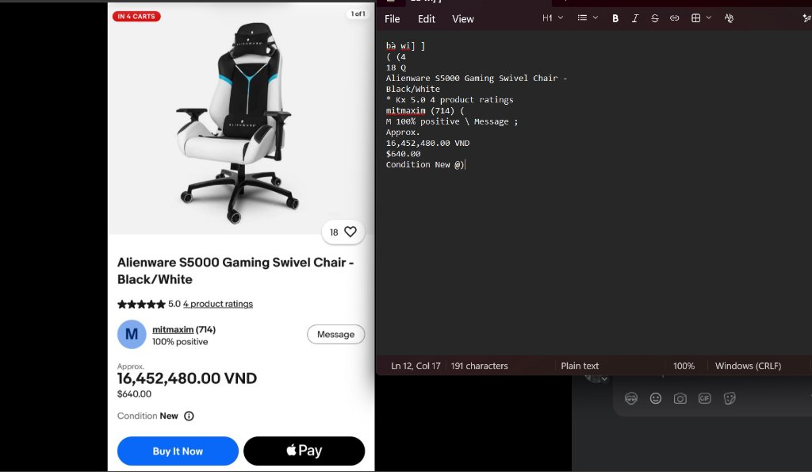

# Product Documentation — Image Text Selector (v1.2.0)

## 1. Product Overview

**Image Text Selector** is a privacy-first, offline-capable Chrome/Edge (Manifest V3) extension that converts text inside web images, videos, canvases, and UI cards into selectable and copyable text.

### Design & UX Identity
- **99% Crimson & Obsidian Theme:** High-contrast obsidian black surfaces (`#070709`, `#101014`) paired with deep crimson (`#991b1b`–`#dc2626`) accents, inspired by minimalist streetwear/editorial aesthetics.
- **Zero-Friction Workflows:** Three entry points—hover trigger, context menu, and global shortcut (`Alt+Shift+O`)—ensure users can extract text whether it lives inside an `` tag, a CSS background, or a video frame.

---

## 2. System Architecture

| Component | File(s) | Responsibility |
| :--- | :--- | :--- |
| **Service Worker** | `background.js` | Registers context menus & `Alt+Shift+O` command; bypasses image CORS via `fetchImageAsBase64`; captures visible tab screenshots (`captureVisibleTab`); manages the offscreen document lifecycle. |
| **Offscreen Worker** | `offscreen/offscreen.html`, `offscreen/offscreen.js` | Hosts Tesseract.js v7 inside a Web Worker (avoiding page CSP restrictions). Scales images, encodes raw grayscale **PGM** blobs (avoiding `canvas.toBlob` ~1s offscreen delay), runs a secondary downscaled pass for oversized headlines, and keeps the worker warm for 5 minutes. |
| **Content Script** | `content.js`, `styles.css` | Detects hovered images, pre-warms the OCR engine, renders the transparent word-level `<span>` overlay scaled to `clientWidth / naturalWidth`, handles `Ctrl+C` line reconstruction, and drives region capture + result panel. |
| **Settings Popup** | `popup/popup.html`, `popup/popup.css`, `popup/popup.js` | Persists recognition language, scan mode (`fast` / `best`), hover button visibility, and auto-copy preference in `chrome.storage.sync`. |

---

## 3. Test Results & Real-World Evaluation

### Test Case A: E-Commerce Product Card (Region / Image OCR)



**Test Input:** An eBay product listing card (`Alienware S5000 Gaming Swivel Chair - Black/White`) containing mixed typography, UI badges (`IN 4 CARTS`, `1 of 1`), vector icons (heart, stars, info `i`), seller rating, currency conversion (`16,452,480.00 VND`, `$640.00`), and action buttons (`Buy It Now`, `Apple Pay`).

**Actual OCR Output (shown in Notepad on the right):**
```text
bà wi] ]
( (4
18 Q
Alienware S5000 Gaming Swivel Chair -
Black/White
* Kx 5.0 4 product ratings
mitmaxim (714) (
M 100% positive \ Message ;
Approx.
16,452,480.00 VND
$640.00
Condition New @)
```

**Observations:**
- **Accurate core extraction:** Product title, rating numbers, seller handle (`mitmaxim (714)`), positive percentage, both prices (`16,452,480.00 VND` and `$640.00`), and condition (`Condition New`) were recognized accurately with clean line breaks.
- **Artifact noise:** Non-text UI elements (pill badges, heart icon, star icons, info `i` icon, avatar circle) produced garbled tokens (`bà wi] ]`, `( (4`, `18 Q`, `* Kx`, `@)`).
- **Missed inverted/colored buttons:** White text inside high-saturation pills/buttons (`IN 4 CARTS`, `Buy It Now`, `Apple Pay`) was either garbled or omitted.

### Test Case B: Local Playground (`test.html` + `sample-quote.png`)

Open `test.html` directly in Chrome/Edge to verify:
1. Hover trigger placement and pre-warming.
2. Transparent overlay alignment during window resize and scroll.
3. `Show Text` / `Hide Text` toggle and `Copy All` clipboard behavior.

---

## 4. Current Weaknesses & Recommended Fixes

| # | Weakness in v1.2.0 | Root Cause | Recommended Fix |
| :--- | :--- | :--- | :--- |
| **1** | **UI icons & badges produce garbled text** (e.g., `bà wi] ]`, `* Kx`, `@)`) | `extractLines()` in `offscreen.js` only filters words with `confidence >= 25` and non-empty text. Vector icons and borders often score >25 as punctuation or random glyphs. | Raise minimum word/line confidence threshold (e.g., `>= 45` for isolated symbols), filter single-token lines containing only punctuation/brackets, and apply morphological/aspect-ratio heuristics to reject icon blobs. |
| **2** | **Vietnamese diacritic hallucination on English-only UIs** | Default `ocrLanguage` is `vie+eng`. When Tesseract encounters noisy pixels or stylized fonts, it maps them to Vietnamese characters (`bà`, `đ`, etc.). | Add an **Auto-Detect / Quick Switch** toggle or use `eng` fast-pass first when no Vietnamese diacritic candidates are detected, or expose a 1-click language pill directly in the overlay toolbar. |
| **3** | **White text on dark/colored buttons is missed or garbled** (`IN 4 CARTS`, `Buy It Now`, `Apple Pay`) | `encodePgm()` converts RGB directly to grayscale without contrast normalization or polarity inversion; Tesseract performs best on dark text over light backgrounds. | Add adaptive thresholding (Otsu/Sauvola) and automatic background polarity detection (invert dark regions before OCR, or run a contrast-enhanced pass on low-yield regions). |
| **4** | **Single-worker sequential queue** | `offscreen.js` maintains one global `worker` and serializes jobs via `queue`. Switching `lang` or `quality` terminates and recreates the worker (~1–2s penalty). | Pool up to 2 lightweight workers or cache initialized language models in memory if RAM allows; show a clearer "Switching language..." indicator. |
| **5** | **Region OCR limited to visible viewport & `devicePixelRatio` assumptions** | `captureVisibleTab` captures only the visible viewport and scales using `full.naturalWidth / window.innerWidth`, which can drift under browser zoom or CSS transforms. | Use `window.devicePixelRatio` verification + clamp crop bounds safely, and support scrolling-capture or direct `<canvas>` / `<video>` frame extraction when applicable. |
| **6** | **No text post-processing or cleanup** | Raw OCR lines are joined verbatim without trimming stray trailing punctuation or collapsing accidental artifacts. | Add an optional **Clean Text** post-processor (strip orphan symbols, normalize whitespace, optionally format prices/URLs). |

---

## 5. Future Features Roadmap

### Short-Term (v1.3.x)
- **Smart Noise Filter:** Toggleable post-processing to strip icon artifacts and low-confidence single-character garbage.
- **Quick Language Switcher on Toolbar:** Switch between `ENG`, `VIE+ENG`, `JPN`, `KOR`, etc. directly from the floating image toolbar without opening the popup.
- **Image Preprocessing Controls:** Automatic contrast boost and dark-mode inversion toggle for white-on-black/colored UI text.

### Mid-Term (v1.4.x)
- **Instant Translate:** One-click translation of extracted text inside the overlay or region result panel.
- **Structured Data Extraction:** Auto-detect and offer 1-click copy for emails, URLs, phone numbers, tracking codes, and prices.
- **Scan History (Local):** Keep the last 20–50 extracted snippets in `chrome.storage.local` for quick re-copying.

### Long-Term (v2.0)
- **Batch / Full-Page Image Scan:** Scan all images on a page or export extracted text as Markdown/CSV.
- **Table Structure Recognition:** Preserve columns and rows when copying screenshots of spreadsheets, invoices, or pricing tables.
- **Optional Cloud AI Vision Fallback:** Allow users to opt-in to a Vision LLM/API key for handwritten notes, complex math formulas, or heavily stylized graphics while keeping local Tesseract as the default offline engine.
